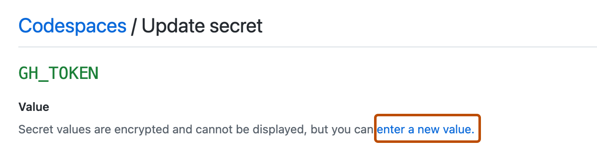
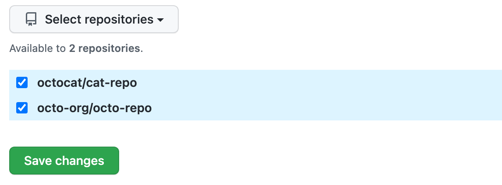
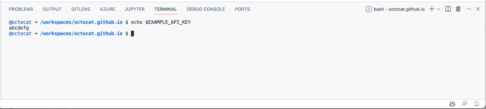

## About secrets for 

You can add development environment secrets to your personal account that you want to use in your codespaces. For example, you may want to store and access the following sensitive information as secrets:

* Access tokens to cloud services
* Service principals
* Subscription identifiers
* Credentials for a private image registry (for more information, see [AUTOTITLE](/codespaces/reference/allowing-your-codespace-to-access-a-private-registry))

You can choose which repositories should have access to each secret. Then, you can use the secret in any codespace you create for a repository that has access to the secret. To share a secret with a codespace created from a template, you will need to publish the codespace to a repository on , then give that repository access to the secret.



### Naming secrets

 For example, a secret created at the repository level must have a unique name in that repository.



### Limits for secrets

You can store up to 100 secrets for .

Secrets are limited to 48 KB in size.

## Adding a secret



1. To the right of "Codespaces secrets", click **New secret**.
1. Under "Name," type a name for your secret.


1. Click **Add secret**.

## Editing a secret

You can update the value of an existing secret, and you can change which repositories can access a secret.



1. Under "Codespaces secrets," to the right of the secret you want to edit, click **Update**.
1. Under "Value," click the link "**enter a new value**."

   



1. Optionally, to remove the secret's access to a repository, deselect the repository.

   

1. Click **Save changes**.

## Deleting a secret



1. Under "Codespaces secrets," to the right of the secret you want to delete, click **Delete**.
1. Read the warning, then click **OK**.

## Managing secrets from inside a codespace

The `GITHUB_TOKEN` that  provides in a codespace can't manage your account-specific  secrets. You can't use this token to list, add, update, or delete these secrets, to get the public key used to encrypt them, or to change which repositories can access them. This restriction doesn't affect repository or organization secrets, or how your secrets are added to your codespaces as environment variables.

To manage your account-specific secrets, we recommend using your  settings in a browser. See [Adding a secret](#adding-a-secret).

If you want to manage these secrets from a codespace terminal, for example with , you must use a credential that you authorize separately. The credential needs permission to manage your  secrets:

* ** tokens and :** The `codespace` scope. The following `gh auth login` command requests this scope in addition to the scopes that  always requests: `repo`, `read:org`, and `gist`. The resulting token can access your repositories, read your organization memberships, and manage your gists, as well as your  secrets. If you don't want to make this access available in the codespace, use your  settings in a browser, or manage your secrets from a trusted local machine.
* **:** The "Codespaces user secrets" account permission, with write access. To give repositories access to a secret, the token must also include each of those repositories, with the "Codespaces secrets" repository permission. If you update a secret that repositories can already access, the token needs this access to each of those repositories too.

> [!WARNING]
> When you authorize a credential in a codespace, code running in that codespace, such as dependencies, extensions, and lifecycle scripts, can use the credential. Only authorize a credential in a codespace if you trust all the code that runs in it. Otherwise, use your  settings in a browser, or manage your secrets from a trusted local machine.

 uses the `GH_TOKEN` environment variable first, then `GITHUB_TOKEN`, and only then the credentials stored by `gh auth login`. Because a codespace sets `GITHUB_TOKEN`, running `gh auth login` on its own isn't enough. On Linux, you can unset these variables for a single command, without removing them from your codespace environment.

1. In the terminal, authenticate  with the `codespace` scope.

   ```shell copy
   env -u GH_TOKEN -u GITHUB_TOKEN gh auth login --hostname github.com --web --scopes codespace
   ```

   If  asks for your preferred protocol for Git operations, choose **HTTPS**. When it asks whether to authenticate Git with your  credentials, answer **No**. If you answer yes, the token can be saved to a Git credential helper, and `gh auth logout` doesn't remove it from there.

1. Run the `gh secret` command you need with the `--user` flag, again unsetting the environment variables for that command. For example, to add or update a secret and give a repository access to it, run the following command, replacing `SECRET-NAME` and `OWNER/REPO`. To give more than one repository access, use a comma-separated list of repositories, each in the `OWNER/REPO` format.  prompts you for the secret value.

   ```shell copy
   env -u GH_TOKEN -u GITHUB_TOKEN gh secret set SECRET-NAME --user --repos OWNER/REPO
   ```

   To list your secrets, run `env -u GH_TOKEN -u GITHUB_TOKEN gh secret list --user`.

1. When you've finished, remove the stored credential from the codespace. Replace `USERNAME` with your  username.

   ```shell copy
   env -u GH_TOKEN -u GITHUB_TOKEN gh auth logout --hostname github.com --user USERNAME
   ```

   Signing out only removes the credential that  stored in the codespace. If you had already signed in to  in the codespace with the same account and hostname, signing in again replaced that stored credential, and signing out doesn't restore your previous sign-in.

   Signing out doesn't revoke the token, so it doesn't protect you if code in the codespace has already copied the credential. If you think a credential might have been exposed, you can revoke your authorization for . Revoking the authorization invalidates all  tokens that it granted, so you may also be signed out of  on other machines, including your local machine. See [AUTOTITLE](/apps/oauth-apps/using-oauth-apps/reviewing-your-authorized-oauth-apps).

> [!WARNING]
> Don't include a secret value or a token in a command. Commands can be saved in your shell history and are visible to other processes.

### Connecting to an enterprise on 

If you access  through a subdomain of , such as ``, use the following commands instead of the commands in the previous steps. Replace `SUBDOMAIN` with your enterprise's subdomain.

1. Authenticate  with your enterprise's hostname.

   ```shell copy
   env -u GH_TOKEN -u GITHUB_TOKEN gh auth login --hostname SUBDOMAIN.ghe.com --web --scopes codespace
   ```

1. Set `GH_HOST` in each `gh secret` command, so that  uses your enterprise's subdomain instead of .

   ```shell copy
   env -u GH_TOKEN -u GITHUB_TOKEN GH_HOST=SUBDOMAIN.ghe.com gh secret set SECRET-NAME --user --repos OWNER/REPO
   env -u GH_TOKEN -u GITHUB_TOKEN GH_HOST=SUBDOMAIN.ghe.com gh secret list --user
   ```

1. When you've finished, sign out using the same hostname.

   ```shell copy
   env -u GH_TOKEN -u GITHUB_TOKEN gh auth logout --hostname SUBDOMAIN.ghe.com --user USERNAME
   ```

## Using secrets

A development environment secret is exported as an environment variable into the user's terminal session.



You can use development environment secrets after the codespace is built and is running. For example, a secret can be used:

* When launching an application from the integrated terminal or ssh session.
* Within a dev container lifecycle script that is run after the codespace is running. For more information about dev container lifecycle scripts, see the documentation on the Development Containers website: [Specification](https://containers.dev/implementors/json_reference/#lifecycle-scripts).

Development environment secrets cannot be used:

* During codespace build time (that is, within a Dockerfile or custom entry point).
* Within a dev container feature. For more information, see the `features` property in the [dev containers specification](https://containers.dev/implementors/json_reference/#general-properties) on the Development Containers website.

## Further reading

* [AUTOTITLE](/codespaces/managing-codespaces-for-your-organization/managing-development-environment-secrets-for-your-repository-or-organization)
* [AUTOTITLE](/codespaces/developing-in-a-codespace/creating-a-codespace-for-a-repository#recommended-secrets)
* [AUTOTITLE](/codespaces/setting-your-user-preferences)
* [AUTOTITLE](/codespaces/customizing-your-codespace)
