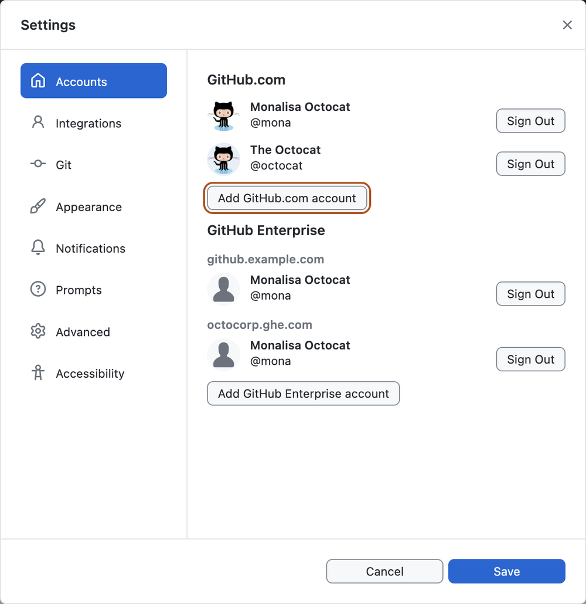
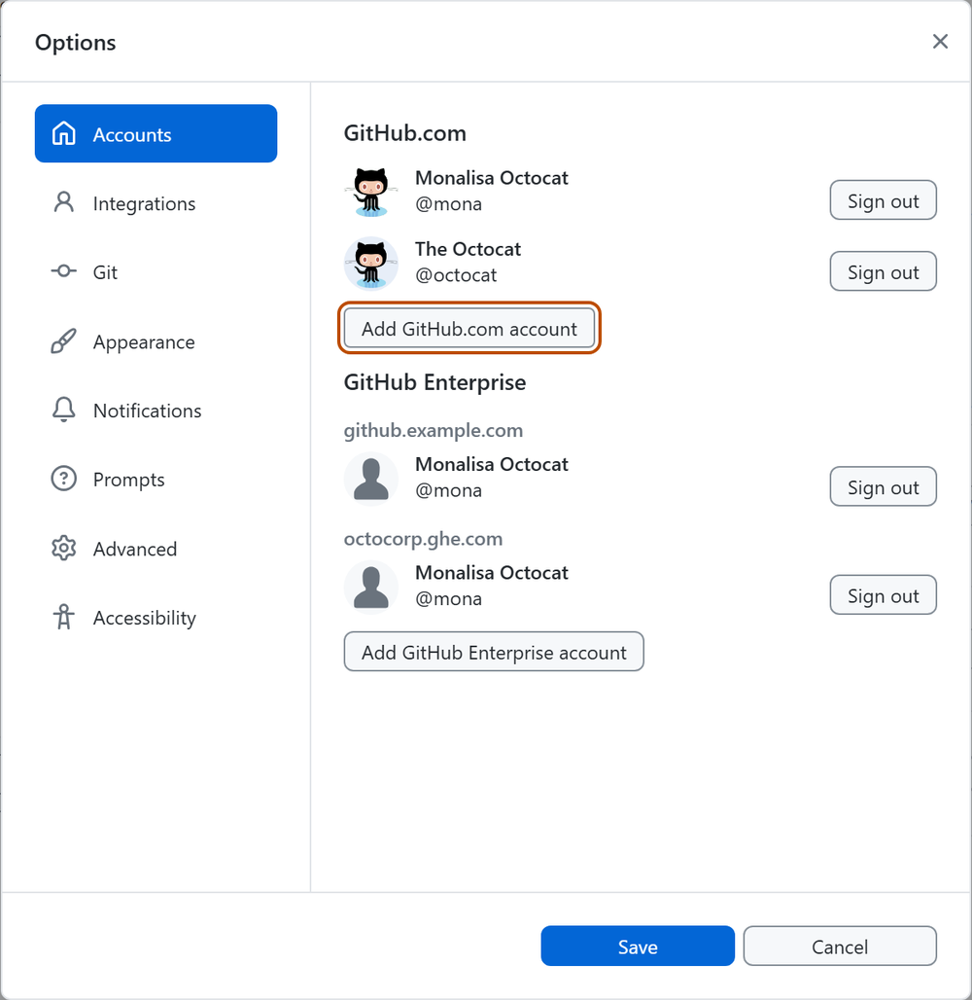
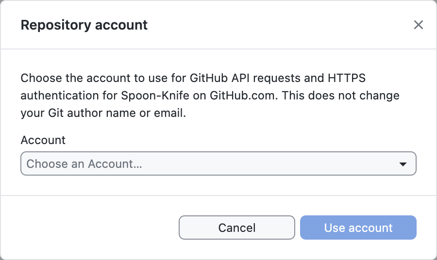
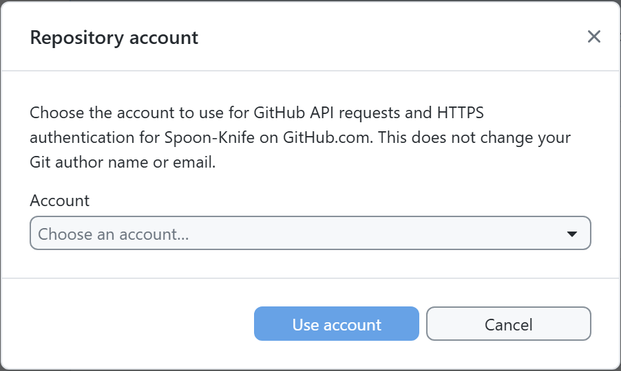
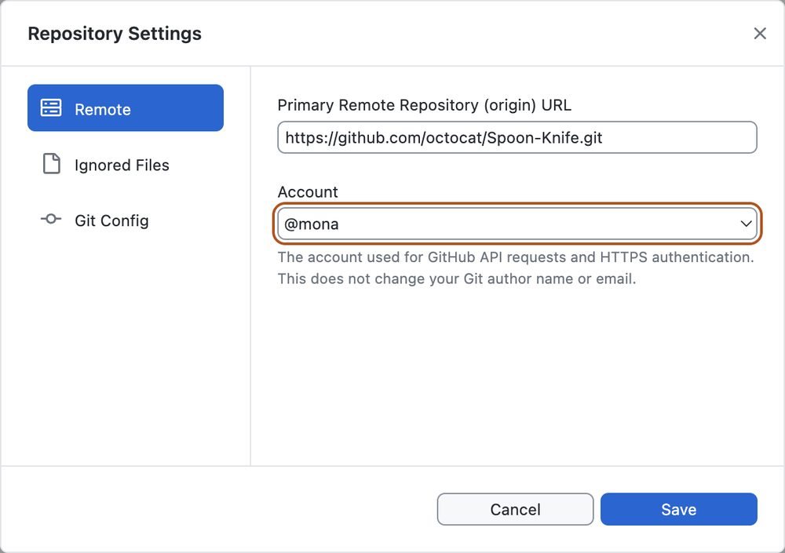
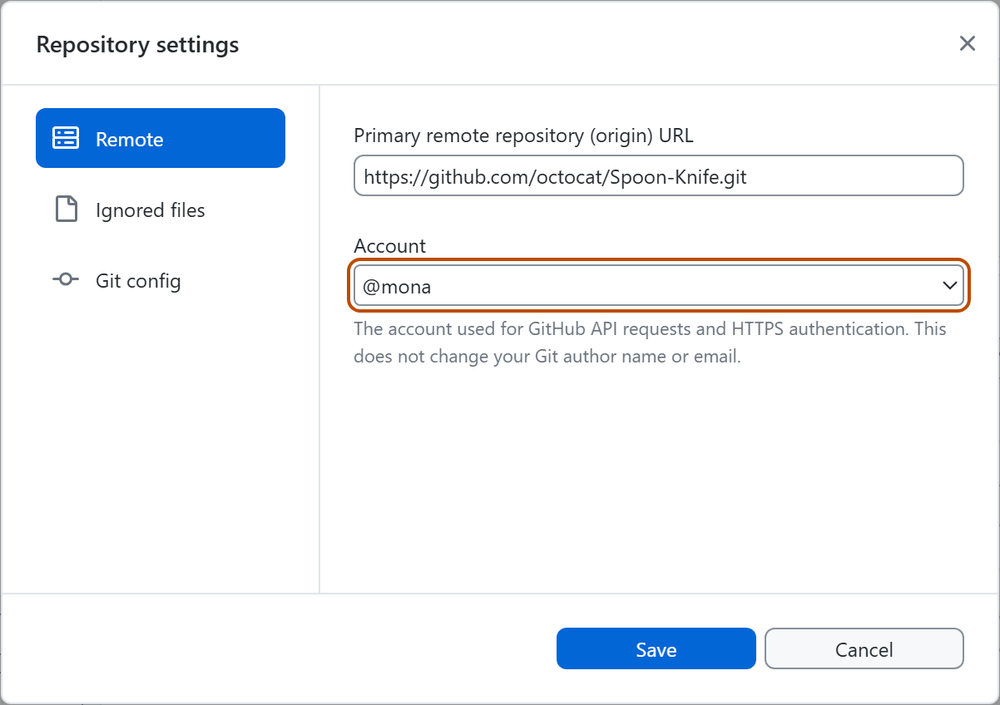
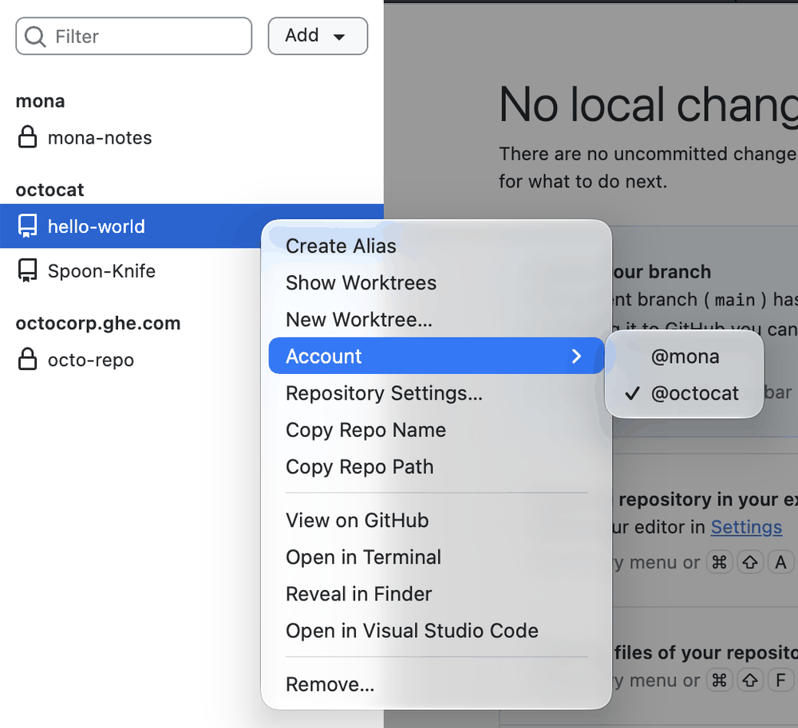
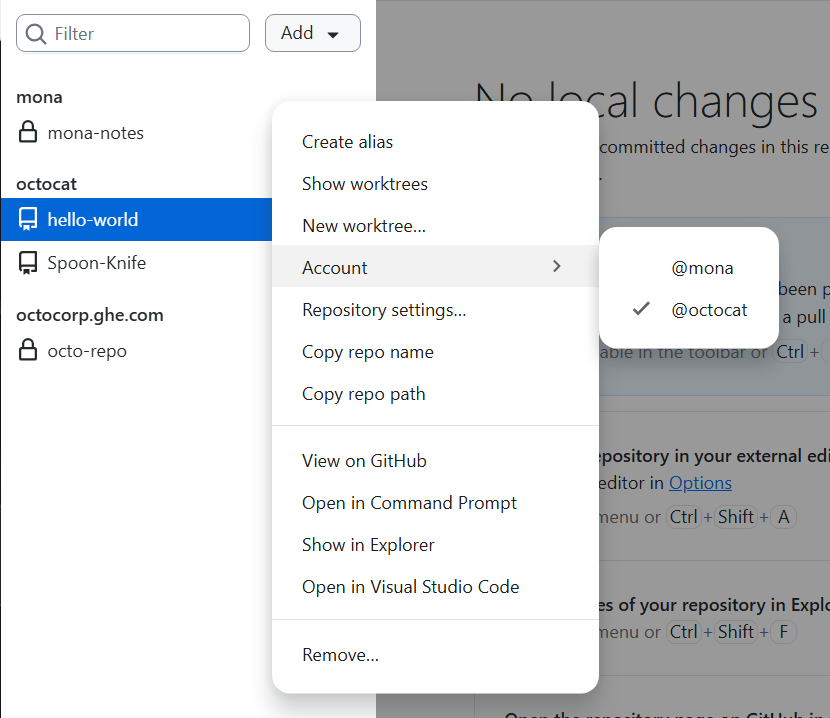
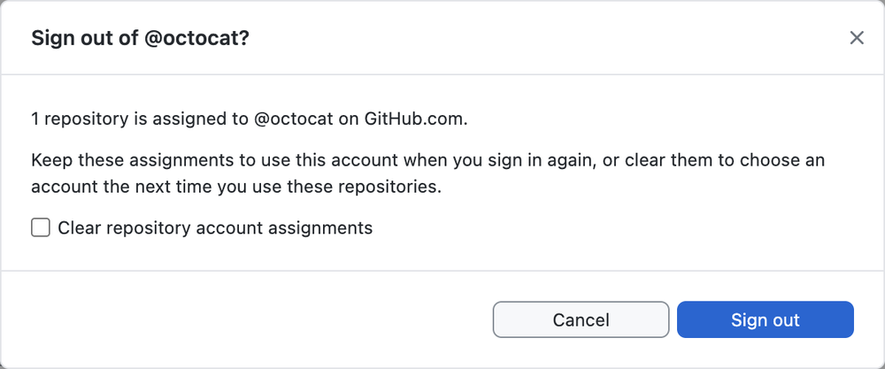
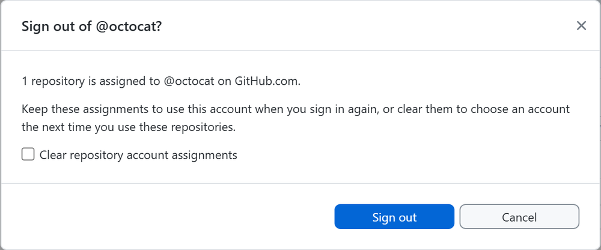

## About multiple accounts

You can sign in to  with more than one account on the same host. For example, you can use a personal account and a work account on , or several accounts on  or . You don't need to sign out of one account to use another.

A repository in  can be assigned to one account on the repository's host.  uses the assigned account for  API requests and for HTTPS authentication when Git pushes, pulls, or fetches.

 features in , such as generating commit messages, use the repository's account if it has access to . Otherwise, they use another signed-in account that does.

If you used  before multiple accounts were supported, each of your existing repositories is assigned to the account you were signed in to on that host. If you only use one account, nothing changes.

> [!NOTE]
> The account assigned to a repository doesn't change the name and email address that Git uses as the author of your commits. For more information, see [AUTOTITLE](/desktop/configuring-and-customizing-github-desktop/configuring-git-for-github-desktop).

## Adding another account





1. In the "Settings" window, on the **Accounts** pane, click **Add  account**. To sign in to  or , click **Add  account** instead.

   

1. Follow the prompts to sign in. See [AUTOTITLE](/desktop/installing-and-authenticating-to-github-desktop/authenticating-to-github-in-github-desktop).

   > [!TIP]
   > Your browser might ask which  account to use, even if you're already signed in. Choose the account you want to add, or sign in to a different account.







1. In the "Options" window, on the **Accounts** pane, click **Add  account**. To sign in to  or , click **Add  account** instead.

   

1. Follow the prompts to sign in. For more information, see [AUTOTITLE](/desktop/installing-and-authenticating-to-github-desktop/authenticating-to-github-in-github-desktop).

   > [!TIP]
   > Your browser might ask which  account to use, even if you're already signed in. Choose the account you want to add, or sign in to a different account.



The "Accounts" pane lists your  accounts under "". Your  and  accounts are listed under "", grouped by hostname.

## How  chooses an account for a repository

 assigns an account to a repository when you clone, add, or publish it.

* **Cloning from the "" tab:** Choose an account from the **Account** dropdown menu at the top of the "Clone a Repository" window. This dropdown menu only appears if you're signed in to more than one account. The list shows the repositories that account can access. When you clone, the repository is assigned to that account. For more information, see [AUTOTITLE](/desktop/adding-and-cloning-repositories/cloning-and-forking-repositories-from-github-desktop).
* **Cloning from the "URL" tab, or adding a local repository:**  checks which of your accounts on the repository's host can access the repository.
  * If one account can access it, the repository is assigned to that account.
  * If more than one account can access it,  asks you to choose. Every account can access a public repository, so you're always asked to choose if you're signed in to more than one account on its host.
  * If none of your accounts can access it, the repository is added without an assigned account. If you're cloning a private repository over HTTPS, the clone fails.
* **Publishing a repository:** Choose an account from the **Account** dropdown menu in the "Publish Repository" window. If the repository's assigned account is signed in, that account is selected. For more information, see [AUTOTITLE](/desktop/adding-and-cloning-repositories/adding-an-existing-project-to-github-using-github-desktop).

### Choosing an account when  asks

If a repository doesn't have an assigned account, the "Repository account" window opens when  needs one. For example:

* Git needs HTTPS credentials to push or pull.
*  refreshes pull requests or creates a fork.

Background fetches never open this window. If you aren't signed in to any account on the repository's host,  asks you to sign in instead.

If the repository's assigned account is signed out, the "Repository account" window asks you to sign in to that account. Click **Sign in** to sign in again. If you're signed in to another account on the same host, you can click **Choose another account** to assign that account to the repository instead.

To choose an account for a repository that doesn't have one:

1. In the "Repository account" window, select the **Account** dropdown menu, then click the account you want to use for this repository. The list only shows accounts on the repository's host.

   If the account you want isn't listed, click **Cancel**, sign in to the account, then try again. For more information, see [Adding another account](#adding-another-account).

   

   

   

   

   

   

1. Click **Use account**.

## Changing the account for a repository

You can change the account for any repository that has a remote on , , or . You can only choose accounts that are signed in to the repository's host.

### Using repository settings


1. In the "Repository Settings" window, on the **Remote** pane, select the **Account** dropdown menu, then click the account you want to use.

   To remove the repository's account, click **None (unassigned)**.

   

   

   

   

   

   

1. Click **Save**.

### Using the repository list

If a repository has a remote on a  host and there's more than one account to choose from, you can switch the repository's account from the repository list.

1. In the repository bar, click **Current Repository**.
1. Right-click the repository, select **Account**, then click the account you want to use.

   The current account has a checkmark. If the current account is signed out, it's listed as "@USERNAME (Signed out)".

   

   

   

   

   

   

You can also open a repository's settings from the same context menu. Right-click the repository, then click **Repository Settings…**.

## Signing out of an account

When you sign out of an account that has repositories assigned to it,  asks whether to keep those assignments.





1. In the "Settings" window, on the **Accounts** pane, next to the account you want to sign out of, click **Sign Out**.
1. If repositories are assigned to the account, choose what happens to them in the "Sign out of @USERNAME?" window.
   * To keep the assignments, leave **Clear repository account assignments** deselected. When you sign in to the account again,  uses it for these repositories again.
   * To remove the assignments, select **Clear repository account assignments**.  asks you to choose an account the next time it needs credentials for these repositories.

   

1. Click **Sign out**.







1. In the "Options" window, on the **Accounts** pane, next to the account you want to sign out of, click **Sign out**.
1. If repositories are assigned to the account, choose what happens to them in the "Sign out of @USERNAME?" window.
   * To keep the assignments, leave **Clear repository account assignments** deselected. When you sign in to the account again,  uses it for these repositories again.
   * To remove the assignments, select **Clear repository account assignments**.  asks you to choose an account the next time it needs credentials for these repositories.

   

1. Click **Sign out**.



If the account’s token is no longer valid and  removes the account, the repository assignments are kept.

## Further reading

* [AUTOTITLE](/desktop/installing-and-authenticating-to-github-desktop/about-connections-to-github-in-github-desktop)
