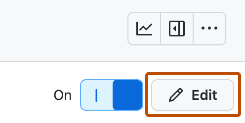







 includes built-in workflows that you can use to update the **Status** of items based on certain events. For example, you can automatically set the status to **Todo** when an item is added to your project, close issues when the issue's status in your project is changed, or set the status to **Done** when an issue is closed.

When your project initializes, two workflows are enabled by default: When issues or pull requests in your project are closed, their status is set to **Done**, and when pull requests in your project are merged, their status is set to **Done**.



If the project's **Status** field syncs with issue statuses, workflows that set **Status** use the option that matches each issue's status, and moving an issue's item can change the issue's status. For more information, see [AUTOTITLE](/issues/tracking-your-work-with-issues/learning-about-issues/about-issue-statuses#syncing-statuses-with-projects).



You can also configure workflows to automatically archive items when they meet set criteria and to automatically add items from a repository when they match a filter. For more information, see [AUTOTITLE](/issues/planning-and-tracking-with-projects/automating-your-project/archiving-items-automatically) and [AUTOTITLE](/issues/planning-and-tracking-with-projects/automating-your-project/adding-items-automatically).

## Enabling a built-in workflow

You can enable or disable the built-in workflows for your project.


1. Under "Default workflows," click on the workflow that you want to edit.
1. In the top right, click **Edit**.

   

1. Depending on the workflow you have selected, make changes to the fields to configure the workflow's behavior.
1. To save your changes and enable the workflow, click **Save and turn on workflow**.



## Turning off the issue status sync

By default, a project's **Status** field syncs with issue statuses. You can turn off the sync for one project. Built-in workflows still run with their configured options, so **Item closed** can still set **Status** when an issue closes, and **Auto-close issue** can still close an issue when its item's **Status** changes.

People with write access to the project can change the setting. Copies of the project, and projects created from it as a template, keep the setting.


1. In the list of workflows, click **Sync with issue status**.
1. Click the toggle to turn the sync off or on.

When you turn the sync back on, items don't change right away. For each issue and its project item, syncing resumes the next time the issue's status changes, someone moves the item, or a built-in workflow sets its **Status**. Depending on the change, the issue's status can update the item, or the item's **Status** can update the issue's status.


