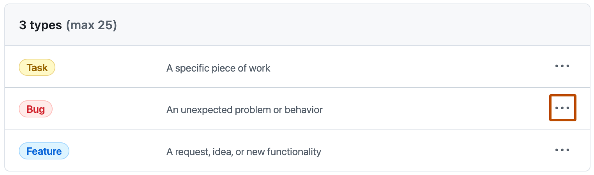

You can use issue types to classify and manage different types of issues across your organization and user-owned repositories. You can create up to  issue types that you can apply to issues, making it easier for you and your members to find issues and plan work.

Default issue types are included in every organization and user account, but these can edited, disabled, or deleted. The default types are task, bug, and feature.

When you add an issue type to an issue, the type will be shown on any lists of issues and in the issues themselves. You can filter and search by issue type and use issue types when creating filters and views in your projects. See [AUTOTITLE](/issues/tracking-your-work-with-issues/using-issues/filtering-and-searching-issues-and-pull-requests#filtering-by-issue-type) and [AUTOTITLE](/issues/planning-and-tracking-with-projects/customizing-views-in-your-project/filtering-projects#filtering-by-issue-type).

## Adding an issue type

1. Under your organization name or user profile, click  Settings.
1.  select  Planning, then click Issue types.
1. On the right side of the page, click **Create new type**.
1. Under "Type name", type the name of your new issue type.
1. Under "Description", to help other people understand the purpose of your new issue type, type a description.
1. Under "Color", click on the color you would like for the new issue type.
1. Click **Create**.

## Making changes to issue types

You can change the name, description, and color of your issue types.

You can also choose to disable or delete an issue type. If you disable an issue type, it will not be shown and it won't be possible to set an issue to that type, but if you later decide to enable the issue type, it will be displayed again on any issues previously set to the issue type. If you delete an issue type, it is permanently removed.

1. Under your organization name or user profile, click  Settings.
1.  select  Planning, then click Issue types.
1. To the right of the issue type you want to make changes to, click .

   

1. In the menu, click **Edit** and make your changes.
    * To make changes to the type name, description, or color, click **Save**.
    * To disable or delete the issue type, in the "Danger zone", click **Disable** or **Delete** and follow the prompts.
