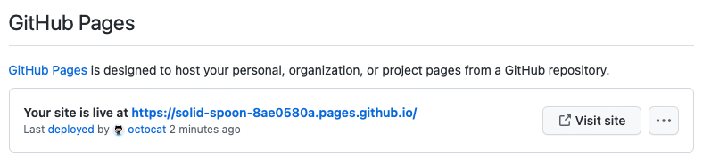



For information about who can access a privately published site, how its subdomain works, and what happens to it if your organization stops using , see [AUTOTITLE](/pages/getting-started-with-github-pages/about-privately-published-github-pages-sites).

## Changing the visibility of your  site




1. Under "", select the ** visibility** dropdown menu, then select a visibility.
1. To see your published site, under "", click ** Visit site**.

   

  
