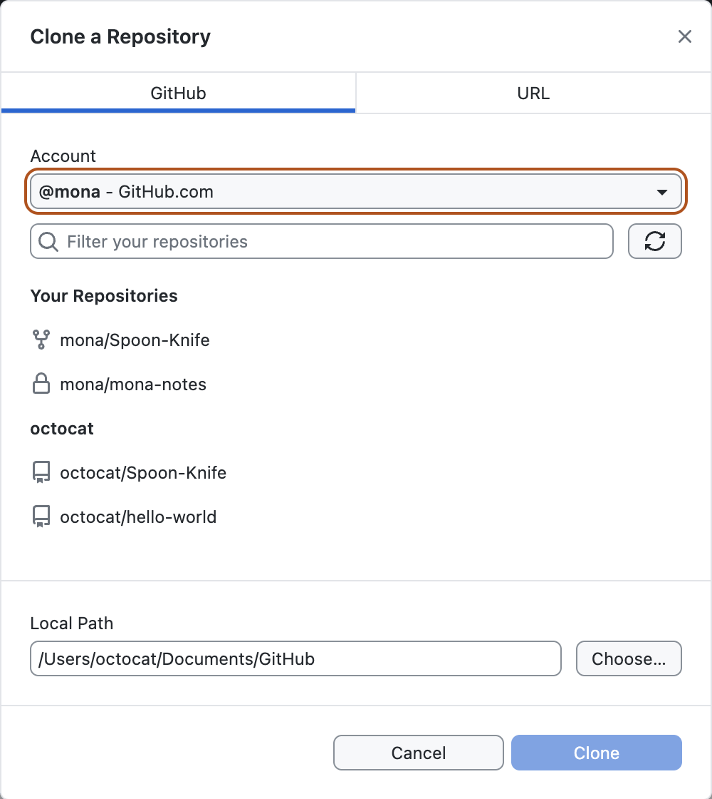
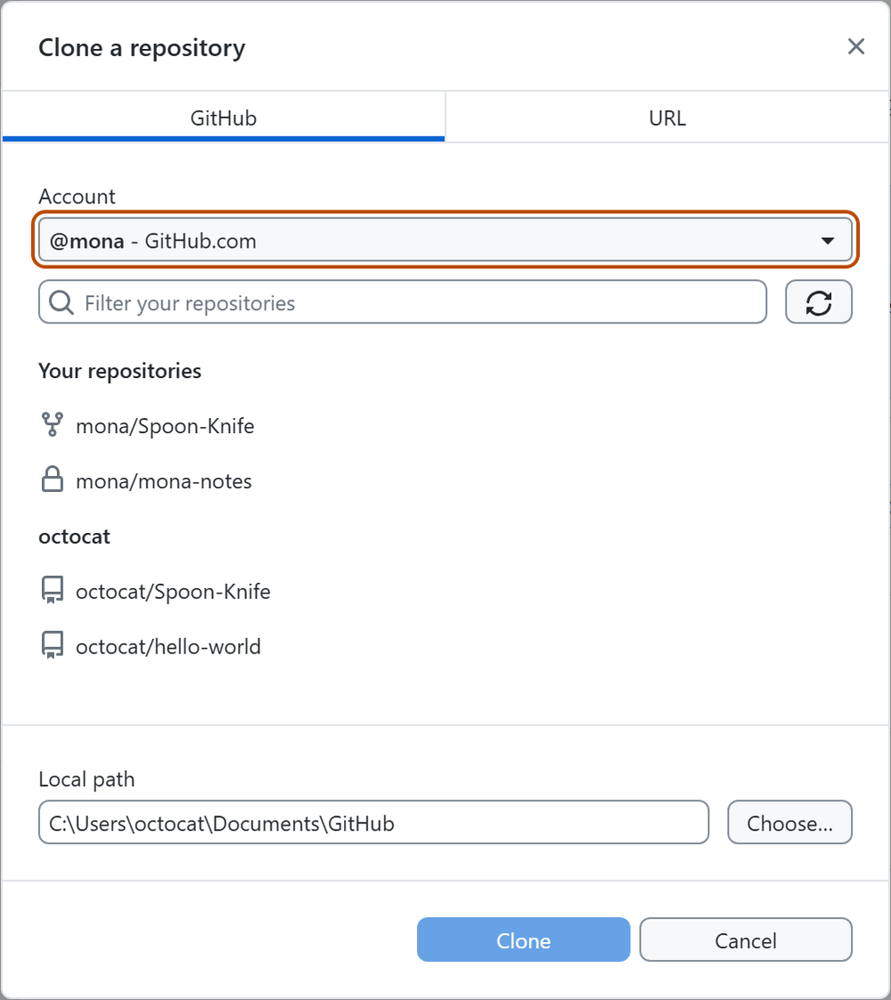

1. Click the **** tab. If you're signed in to more than one account, select the **Account** dropdown menu, then click the account whose repositories you want to see. The repository is assigned to this account when you clone it. You can also click **URL** to manually enter the repository location.

   

   

   

   

   

   
