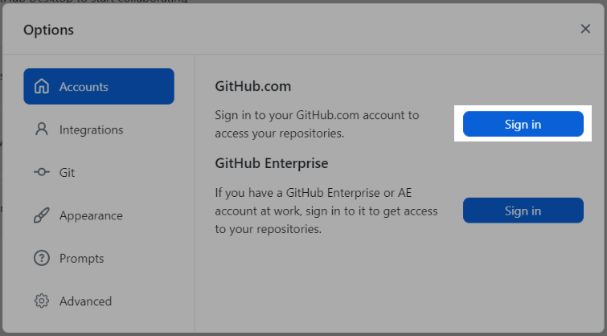

1. In the "Options" window, on the **Accounts** pane, click the appropriate "Sign Into" button. Use **Sign Into ** to sign into  or .

   If you're already signed in to an account in that section, click **Add  account** or **Add  account** instead.

   
